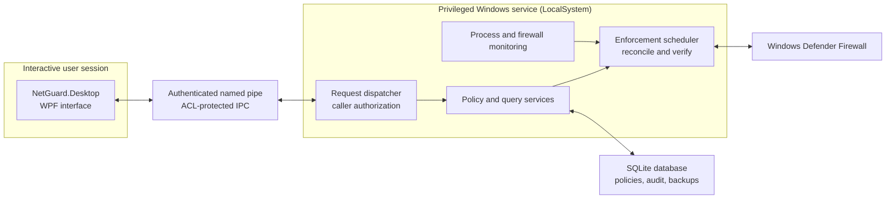

# 🛡️ NetGuard Enterprise

[](https://dotnet.microsoft.com/)
[](#-prerequisites)
[](#-technology-stack)
[](#-security-and-enforcement)
[](#-technology-stack)
[](#-system-architecture)

**Per-application network control for Windows 10 and 11.** Select an application and set its outbound network policy to **Block**, **Custom** (allow only selected destinations and ports), or **Allow**. A Windows service applies and verifies narrowly scoped Windows Defender Firewall rules for the application's executable files.

NetGuard changes only rules it owns. It does not disable Windows Defender Firewall or other security features, and it does not bypass licensing, activation, DRM, or security controls.

---

## 🏛️ System Architecture



The desktop client requests operations over local IPC; the service makes authorization decisions and owns policy enforcement. Rules are verified by reading them back from Windows Firewall. Persistent rules remain in the firewall across application and user-session exits, and the service verifies them again at startup.

## 🌟 Technology Stack

| Layer | Technologies | Responsibility |
|---|---|---|
| Desktop | .NET 9, WPF | Policy management, status, diagnostics, light/dark themes |
| Service | .NET 9 Worker Service, Windows Services | Authorization, policy operations, enforcement orchestration |
| Domain and core | C# / .NET 9 | Policy model, validation, rule planning, reconciliation, monitoring workflows |
| Windows integration | Windows Defender Firewall COM, WMI, ETW, Windows Event Log | Firewall rules, process observation, identity verification, diagnostics |
| Persistence | SQLite | Policies, migrations, audit events, and database backups |
| Service IPC | ACL-protected named pipes | Framed request/response communication and caller identity |
| Installer | WiX v5 MSI | Per-machine installation, Windows service registration, upgrade and uninstall |
| Testing | xUnit | Unit tests and Windows integration tests, including gated firewall and traffic scenarios |

## 🧩 Key Capabilities

### 1. 🧱 Per-application policies

* **Block:** prevent an application's executable from making outbound connections.
* **Custom:** allow-list selected IP addresses, networks, ranges, and ports.
* **Allow:** leave the application unmanaged by NetGuard's blocking rules; existing system policy still applies.
* Apply policies persistently, or only while the application is running.
* Select which Windows network profiles a policy applies to, and manage reusable profiles and time-limited exceptions.

### 2. 🔍 Application discovery and identity

* Scan for applications or add an executable directly.
* Resolve and record the canonical executable path, SHA-256 hash, and Authenticode signature.
* Find and optionally manage helper executables from the same folder.
* Observe related processes and helper activity in Diagnostics.

### 3. ✅ Verified enforcement and recovery

* Create narrowly scoped outbound block rules for managed executable paths.
* Read rules back from the firewall and report **Enforced** only when the intended rules are verified and active for the current network.
* Detect and repair drift after firewall changes, service restarts, or periodic integrity checks.
* Preserve orphaned rules rather than risk silently removing a restriction.
* Explain degraded, inactive, failed, standby, and exception-active states in the interface.

### 4. 🏢 Administration and organization policy

* Let local authenticated users view status by default; require an elevated administrator or **NetGuard Operators** membership to manage policies.
* Deploy organization-managed policies from `%ProgramData%\NetGuard\Policies\organization-policy.json`.
* Audit policy changes and denied requests.
* Export/import configuration, create database backups, and generate redacted diagnostic reports.

### 5. 📜 Diagnostics and audit

* Review application activity, firewall state, observations, service logs, and policy audit events.
* Optionally show blocked-connection notifications when Windows Filtering Platform failure auditing (event 5157) is enabled.
* Generate diagnostic reports with redaction of usernames, user-profile paths, and computer name enabled by default.

## 📁 Repository Structure

| Path | Purpose |
|---|---|
| `src/NetGuard.Domain` | Domain entities, policies, address/port arithmetic, and validation |
| `src/NetGuard.Contracts` | IPC commands, envelopes, DTOs, and shared JSON options |
| `src/NetGuard.Core` | Rule planning, reconciliation, policy services, queries, diagnostics, and authorization |
| `src/NetGuard.Platform.Windows` | Windows Firewall, process monitoring, executable identity, discovery, and event watchers |
| `src/NetGuard.Persistence.Sqlite` | SQLite persistence, migrations, backups, and audit storage |
| `src/NetGuard.Ipc` | Named-pipe framing, access control, and caller/server verification |
| `src/NetGuard.Service` | Windows service host and request dispatcher |
| `src/NetGuard.Desktop` | WPF user interface |
| `src/NetGuard.Logging` | Structured JSON-lines logging and retention |
| `tests/NetGuard.Tests.Unit` | Unit tests using fakes at operating-system boundaries |
| `tests/NetGuard.Tests.Integration` | SQLite, firewall, process, pipe, signature, and gated traffic tests |
| `tools/NetGuard.NetProbe`, `tools/NetGuard.TestServer` | Controlled applications for end-to-end network testing |
| `installer/` | WiX v5 MSI project |
| `scripts/` | Build, test, publish, signing, installer, and developer install scripts |
| `schemas/` | Policy import/export JSON Schema |
| `docs/` | Architecture, deployment, limitations, security, testing, and threat model |

## 💻 Prerequisites

* Windows 10 (version 1809 or later) or Windows 11, x64.
* .NET SDK 9.0.200 or later to build.
* Visual Studio 2022 17.12+ with the .NET desktop development workload (optional).
* Administrator rights to install the service or run tests that modify the firewall.
* To produce a signed release: Windows SDK signing tools (`signtool.exe`) and an Authenticode code-signing certificate.

Installed systems do not need a separate .NET runtime; the MSI publishes self-contained binaries.

## 🚀 Run the Application

### Run an installed copy

1. Install NetGuard using the MSI (see [Build, Test, Publish, and Install](#-build-test-publish-and-install)). The installer registers `NetGuardService` to start automatically and adds a Start menu shortcut.
2. Open **NetGuard Enterprise** from the Start menu. If the service is stopped, open an elevated PowerShell prompt and run:

   ```powershell
   Start-Service NetGuardService
   ```

3. Use **Restart as administrator** in the application if you need to make policy changes and are not a member of **NetGuard Operators**.

### Run a development build

From the repository root, use an elevated PowerShell prompt to build and install the development service:

```powershell
.\scripts\build.ps1
.\scripts\install-dev.ps1
```

`build.ps1` restores, builds, and runs the unit and integration suites. `install-dev.ps1` registers and starts the locally built service as LocalSystem. Then, from a regular (non-elevated) PowerShell prompt, launch the desktop application:

```powershell
& .\src\NetGuard.Desktop\bin\Release\net9.0-windows\NetGuard.Desktop.exe
```

For service diagnostics instead of the installed service, run `NetGuard.Service.exe --data-dir C:\Temp\ng` from an elevated prompt. A non-elevated console service can start, but enforcement reports **Failed** rather than claiming privileged work succeeded. To develop the UI against a non-elevated console service, use a Debug build and start the desktop app with `--dev-trust-current-user`; this switch is not included in Release builds.

## 🖥️ Using NetGuard

1. Open **NetGuard Enterprise** from the Start menu. Status viewing is allowed for all users by default.
2. To manage policies, use **Restart as administrator** in the banner or sign in as a member of the local **NetGuard Operators** group.
3. Select **Application Discovery** → **Scan**, or **Managed Applications** → **Add application…**, and choose an executable.
4. Choose **Block internet access**, **Custom allow-list**, or **Allow**. Configure rule retention and applicable network profiles.
5. Check the status. **Enforced (verified)** means the rules were read back from the firewall and the firewall is active on the current network.

Closing the desktop app, logging off, or rebooting does not remove persistent firewall rules. The Windows service verifies enforcement again at startup.

## 🔒 Security and Enforcement

* Only the Windows service runs privileged; the desktop interface runs as the interactive user.
* The service can create only enabled outbound block rules scoped to an executable path. It cannot create allow or inbound rules or disable the firewall.
* The caller's Windows identity is obtained from the named-pipe client token, not from request data. Commands are permission-checked by the service.
* NetGuard modifies only rules bearing both its firewall group and a well-formed ownership key.
* Executables are inspected by the service using a canonical path, SHA-256, and Authenticode verification.
* The status is never represented as enforced unless firewall state and planned rules are verified.

**Scope note:** executable-based filtering cannot block traffic a program delegates to another process or shared Windows service. Packaged (MSIX) applications are reported as unsupported. Read [docs/LIMITATIONS.md](docs/LIMITATIONS.md) for details and mitigations.

## 🧪 Build, Test, Publish, and Install

| Task | Command |
|---|---|
| Build and run automated tests | `.\scripts\build.ps1` |
| Run unit tests | `dotnet test tests\NetGuard.Tests.Unit` |
| Run integration tests | `dotnet test tests\NetGuard.Tests.Integration` |
| Publish self-contained binaries | `.\scripts\publish.ps1 -Version 1.0.0` |
| Build signed release EXE and MSI installers | `.\scripts\build-installer.ps1 -Version 1.0.0 -Thumbprint <cert thumbprint>` |
| Build unsigned internal EXE and MSI installers | `.\scripts\build-installer.ps1 -Version 1.0.0 -Unsigned` |
| Share the installer | Send `artifacts\installer\NetGuardEnterprise-1.0.0-x64.exe`; run it as administrator |
| Silent install | `msiexec /i NetGuardEnterprise-1.0.0-x64.msi /qn /l*v install.log` |
| Silent uninstall (removes NetGuard-owned rules) | `msiexec /x NetGuardEnterprise-1.0.0-x64.msi /qn` |
| Uninstall while keeping rules | `msiexec /x NetGuardEnterprise-1.0.0-x64.msi /qn KEEPRULES=1` |

The EXE bundles the MSI and installs the desktop app and Windows service; it is not a portable app. Never distribute unsigned builds. See [docs/DEPLOYMENT.md](docs/DEPLOYMENT.md) for signing, managed deployment, organization policy, upgrade, and uninstall guidance. Firewall-write and end-to-end traffic tests are gated; see [docs/TESTING.md](docs/TESTING.md) for their requirements and manual scenarios.

## 📦 Data Locations

| Location | Contents | Access |
|---|---|---|
| `%ProgramData%\NetGuard\data\netguard.db` | Policies, state, and audit log | SYSTEM, Administrators |
| `%ProgramData%\NetGuard\data\backups\` | Automatic and manual database backups (last 20) | SYSTEM, Administrators |
| `%ProgramData%\NetGuard\logs\` | Service logs in JSON-lines format | SYSTEM, Administrators |
| `%ProgramData%\NetGuard\Policies\organization-policy.json` | Organization policy | SYSTEM, Administrators |
| `%LOCALAPPDATA%\NetGuard\desktop-preferences.json` | Per-user theme and notification preferences | The user |
| Windows Event Log → Application, source "NetGuard Enterprise" | Warnings and errors | Standard |

## 🩺 Troubleshooting

| Symptom | What to check |
|---|---|
| The service is not reachable | Run `Get-Service NetGuardService`. If stopped, check the Application event log and `%ProgramData%\NetGuard\logs`. |
| An application shows **Failed** | Open its details in **Managed Applications**. Check that the service is running as LocalSystem and the Windows Firewall service (`mpssvc`) is running. NetGuard does not start or change the firewall service. |
| Status is **Degraded** | The firewall may be off for the current profile, Group Policy may prevent local rule merging, or another rule may conflict. Review the details pane and **Firewall Policies** page. |
| Status is **Inactive on this network** | The policy may target a different network profile than the active one. |
| The application still connects | Check **Diagnostics → Observations** for helper processes, and review [docs/LIMITATIONS.md](docs/LIMITATIONS.md). Existing connections may persist until the application restarts. |
| Orphaned rules appear on the Firewall page | These may remain after a configuration reset or restore. NetGuard retains them to avoid unexpectedly unblocking an application; an administrator can remove them from the UI. |
| Remove NetGuard rules from an elevated prompt | Run `"C:\Program Files\NetGuard Enterprise\Service\NetGuard.Service.exe" cleanup-rules`. Use `list-rules` to preview; cleanup removes only rules carrying NetGuard's ownership marker. |
| Collect support information | Use **Diagnostics → Generate**. Redaction of usernames, profile paths, and computer name is enabled by default. |

## 📚 Documentation

* [Architecture](docs/ARCHITECTURE.md) — components, data flow, reconciliation, startup, recovery, and requirements traceability.
* [Security](docs/SECURITY.md) — privilege model, authorization, IPC hardening, data protection, and signing.
* [Threat model](docs/THREAT_MODEL.md) — assets, trust boundaries, STRIDE analysis, and residual risks.
* [Limitations](docs/LIMITATIONS.md) — capabilities and limits of executable-based filtering.
* [Testing](docs/TESTING.md) — automated test suites, gated tests, and manual scenarios.
* [Deployment](docs/DEPLOYMENT.md) — build, sign, install, organization policy, upgrades, and uninstall.
